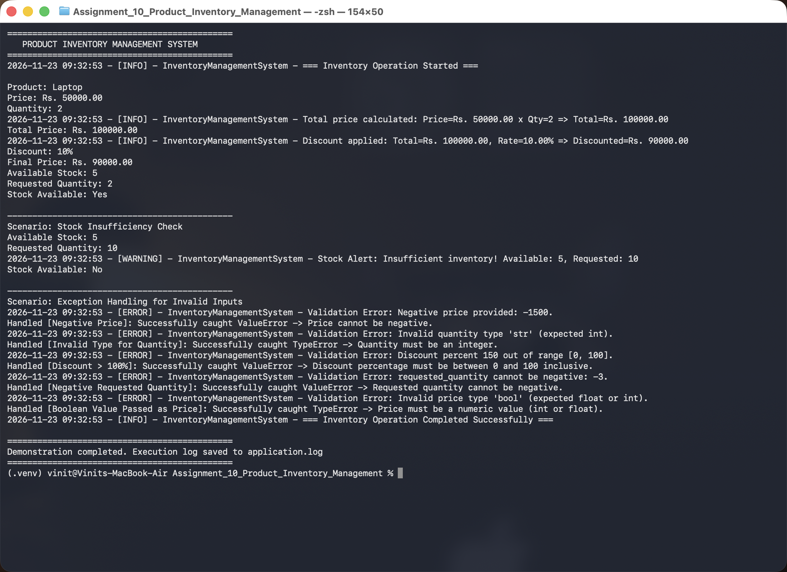
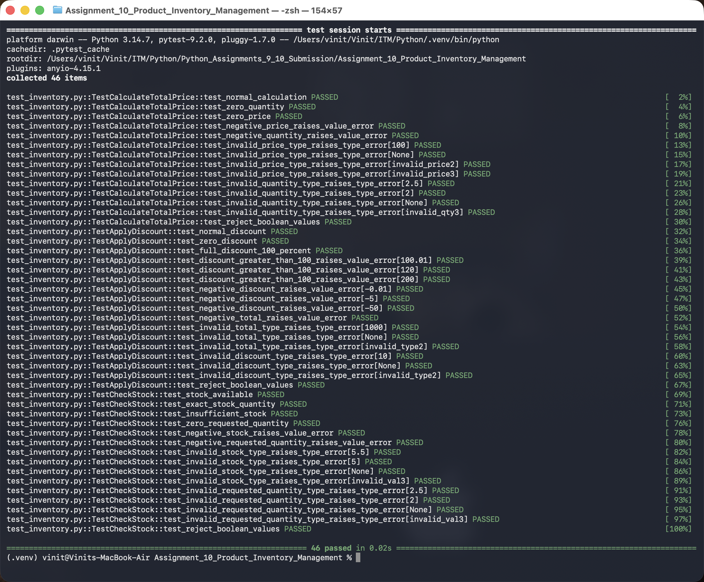
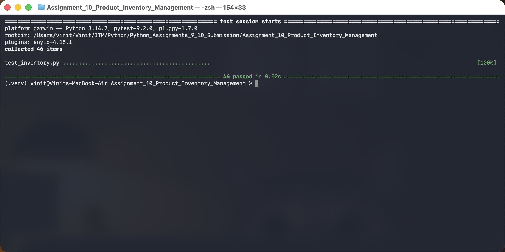
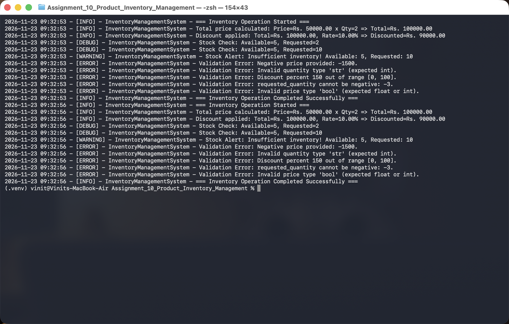
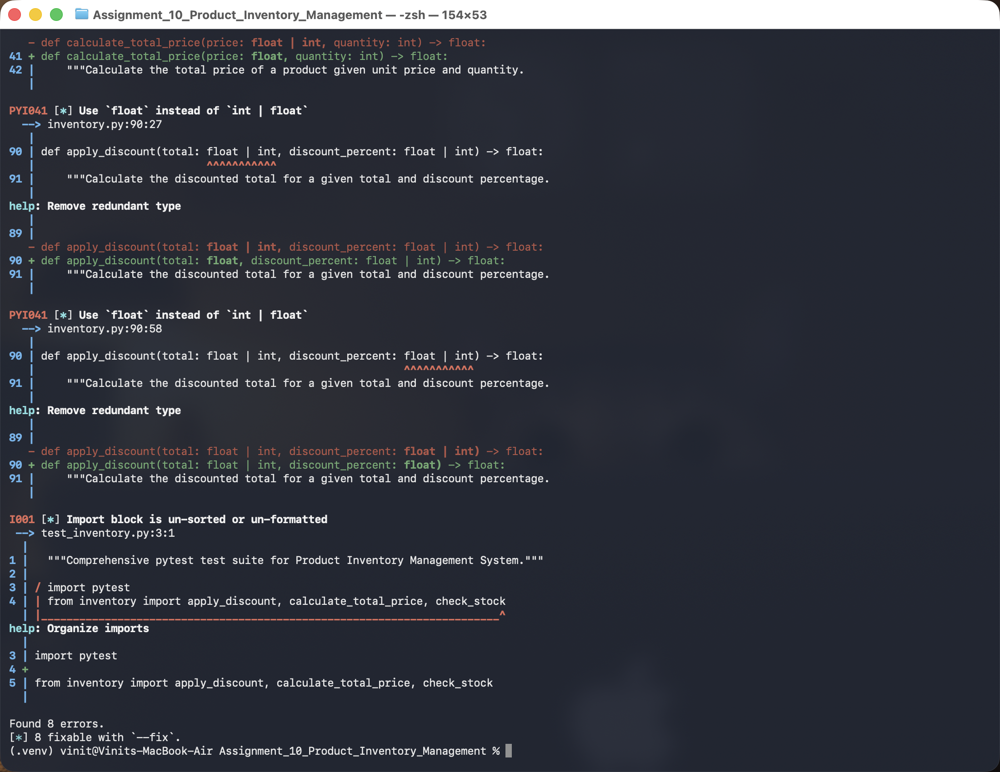
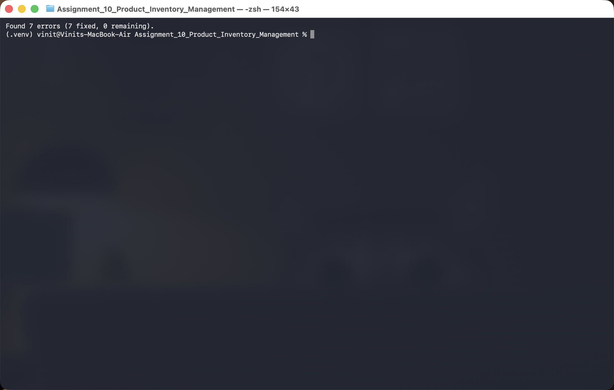
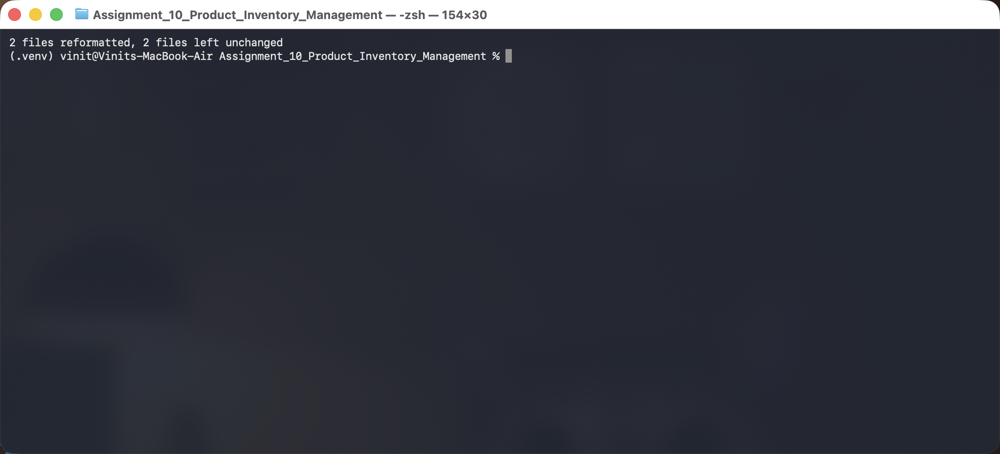
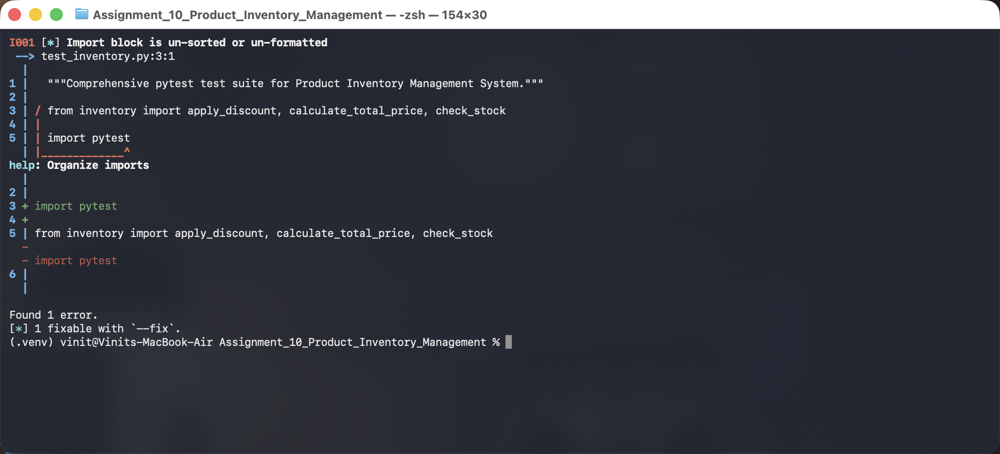

# Product Inventory Management System

MCA Python Programming — Assignment 10

A modular, clean, and beginner-friendly Python application that implements core inventory operations including product price calculation, discount processing, stock availability verification, structured application logging, automated pytest unit testing, and static analysis with Ruff.

---

## Project Description

In retail and inventory environments, accurate price calculations, discount application, and stock checks are vital for preventing revenue loss, order fulfillment errors, and customer dissatisfaction. 

The **Product Inventory Management System** implements these business rules using standard Python functions equipped with defensive input validation, comprehensive exception handling, multi-level application logging, and automated testing.

---

## Features

- **Total Price Calculation**: Calculates total price from unit price and item quantity (`total = price * quantity`). Allows 0 quantity and 0 price boundary scenarios while rejecting negative values and invalid types.
- **Discount Processing**: Applies promotional discounts in the range $[0, 100]\%$ using the formula $\text{discounted\_total} = \text{total} - (\text{total} \times \frac{\text{discount\_percent}}{100})$.
- **Stock Availability Verification**: Determines whether customer requested quantities can be fulfilled against available stock. Returns a clear boolean indicator (`True`/`False`).
- **Defensive Input Validation**: Ensures numbers are strictly numeric, quantities are whole integers, ranges are respected, and boolean types (which inherit from `int` in Python) are strictly rejected.
- **Robust Exception Handling**: Raises clear and descriptive `ValueError` and `TypeError` exceptions without unhandled application crashes.
- **Multi-Level Application Logging**: Integrates Python's standard `logging` library across `DEBUG`, `INFO`, `WARNING`, and `ERROR` levels, automatically generating timestamped logs in `application.log`.
- **Automated Unit Testing**: Contains an extensive test suite built with `pytest` covering normal calculations, zero boundaries, negative values, out-of-range inputs, and type rejections.
- **Code Quality & Formatting**: Adheres to modern Python code style standards enforced by **Ruff** for linting and code formatting.

---

## Technologies Used

- **Language**: Python 3.10+
- **Test Runner**: `pytest`
- **Linter & Formatter**: `Ruff`
- **Logging**: Python Standard Library `logging`
- **Package Management**: `uv` / standard `venv` & `pip`

---

## macOS Setup & Installation

### Option 1: Using `uv` (Recommended modern workflow)

```bash
# Navigate to the project directory
cd Assignment_10_Product_Inventory_Management

# Initialize and install dependencies
uv venv
source .venv/bin/activate
uv pip install pytest ruff
```

### Option 2: Using standard `venv` and `pip`

```bash
# Navigate to the project directory
cd Assignment_10_Product_Inventory_Management

# Create virtual environment
python3 -m venv .venv

# Activate virtual environment
source .venv/bin/activate

# Install testing and code quality tools
pip install pytest ruff
```

---

## Execution

To run the interactive inventory demonstration:

```bash
python inventory.py
```

### Example Terminal Output

```text
=============================================
   PRODUCT INVENTORY MANAGEMENT SYSTEM
=============================================

Product: Laptop
Price: Rs. 50000.00
Quantity: 2
Total Price: Rs. 100000.00
Discount: 10%
Final Price: Rs. 90000.00
Available Stock: 5
Requested Quantity: 2
Stock Available: Yes

---------------------------------------------
Scenario: Stock Insufficiency Check
Available Stock: 5
Requested Quantity: 10
Stock Available: No

---------------------------------------------
Scenario: Exception Handling for Invalid Inputs
Handled [Negative Price]: Successfully caught ValueError -> Price cannot be negative.
Handled [Invalid Type for Quantity]: Successfully caught TypeError -> Quantity must be an integer.
Handled [Discount > 100%]: Successfully caught ValueError -> Discount percentage must be between 0 and 100 inclusive.
Handled [Negative Requested Quantity]: Successfully caught ValueError -> Requested quantity cannot be negative.
Handled [Boolean Value Passed as Price]: Successfully caught TypeError -> Price must be a numeric value (int or float).

=============================================
Demonstration completed. Execution log saved to application.log
=============================================
```

---

## Unit Testing

Run the full automated test suite with verbose reporting:

```bash
pytest -v
```

Run with concise tracebacks:

```bash
pytest --tb=short
```

---

## Code Quality & Formatting

Check code quality and enforce standards using Ruff:

```bash
# Run lint check
ruff check .

# Automatically fix fixable issues
ruff check --fix .

# Format code
ruff format .

# Verify formatting without modifying files
ruff format --check .
```

---

## Application Logging

Application activity is automatically written to `application.log` using standard timestamped formatting:

```text
%(asctime)s - [%(levelname)s] - %(name)s - %(message)s
```

Logging levels implemented:
- **DEBUG**: Fine-grained stock checks and internal evaluations.
- **INFO**: Successful start/completion of inventory operations, total calculations, and discounts.
- **WARNING**: Stock alerts when customer request exceeds available warehouse inventory.
- **ERROR**: Validation failures when invalid types or out-of-bounds parameters are supplied.

Inspect the generated log file:

```bash
cat application.log
```

---

## Screenshots

Terminal screenshots demonstrating real execution and verification are stored in `screenshots/`:

### Inventory Execution


### Automated Testing



### Logging & Log File Contents



### Code Quality (Ruff)




